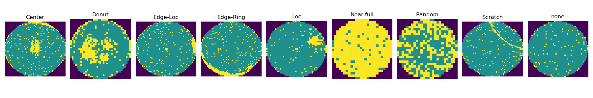
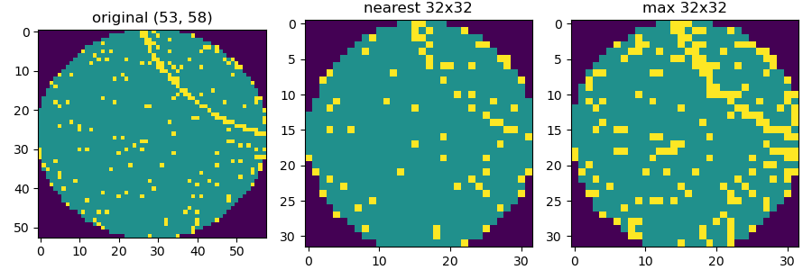
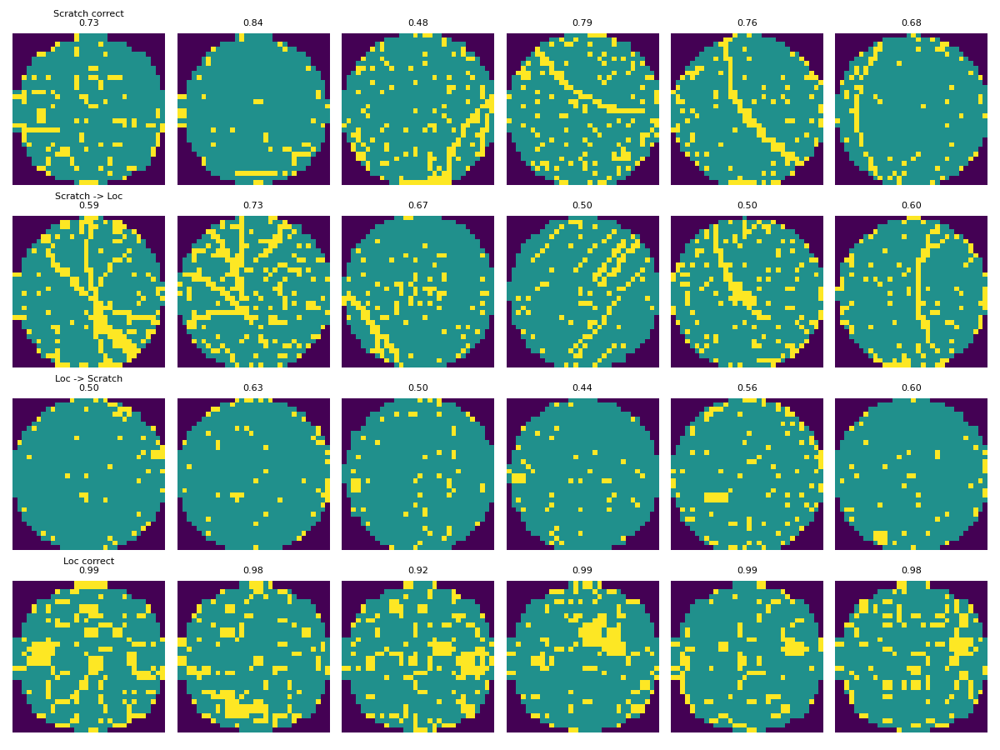

# 웨이퍼 맵 불량 패턴 분류 — 무엇이 진짜 병목인지 실험으로 찾기

실제 반도체 공장의 웨이퍼 맵(WM-811K)을 보고 불량이 **어떤 모양으로 몰려 있는지**(가장자리 고리, 중앙, 긁힘 등) 8가지로 분류하는 PyTorch CNN입니다.
불량 패턴은 원인 공정을 짐작하는 단서가 되기 때문에(예: 긁힘 → 이송 장비, 가장자리 고리 → 증착·식각), 사람이 일일이 보던 분류를 자동화하는 것이 목표입니다.

## 핵심 결과

| | 결과 |
|---|---|
| **최종 성능 (로트 단위 5-fold)** | **macro F1 0.907 ± 0.010**, 정확도 0.939 |
| 가장 어려웠던 Scratch(긁힘) | F1 0.50 → **0.83** |
| 가장 효과가 컸던 것 | 해상도 32×32 → 64×64 (macro F1 0.83 → 0.90) |
| 효과가 없었던 것 | 불균형 보정용 class weight (0.797 → 0.771, 오히려 하락) |

**결론:** 처음에는 Scratch를 못 맞히는 원인을 "개수가 적어서(불균형)"라고 생각했지만, 가중치는 효과가 없었다. 오답을 직접 보니 **작게 줄인 그림에서 긁힘이 끊기고, 특정 방향의 긁힘만 알아보고 있었다.** 회전 증강과 해상도 상향으로 해결했다.

## 데이터

- [WM-811K](http://mirlab.org/dataSet/public/) (MIR Lab): 실제 공정에서 나온 웨이퍼 811,457장, 46,393개 로트
- 웨이퍼 맵 값: 0 = 웨이퍼 바깥, 1 = 정상 칩, 2 = 불량 칩

| 구분 | 개수 |
|---|---|
| 라벨 없음 | 638,507 (78.7%) |
| 패턴 없음 (none) | 147,431 |
| **불량 패턴 8종 (이 프로젝트에서 사용)** | **25,519** |

| 패턴 | 개수 | 패턴 | 개수 |
|---|---|---|---|
| Edge-Ring | 9,680 | Scratch | 1,193 |
| Edge-Loc | 5,189 | Random | 866 |
| Center | 4,294 | Donut | 555 |
| Loc | 3,593 | Near-full | 149 |

가장 많은 패턴과 가장 적은 패턴이 **약 65배** 차이 나는 불균형 데이터다. 그래서 정확도 대신 **macro F1**(8개 패턴을 똑같은 비중으로 평균)을 주 지표로 썼다.



## 평가 방식

- **로트 단위로 나눔:** 같은 로트의 웨이퍼는 서로 닮아서, 공부용과 시험용에 함께 들어가면 점수가 부풀려진다. `StratifiedGroupKFold`로 같은 로트는 한쪽에만 들어가게 했다(겹치는 로트 0개). 원본 데이터의 Training/Test 구분도 로트가 겹치지 않음을 확인했다.
- **시드 3개 반복:** 같은 설정도 시드에 따라 점수가 흔들려서, 평균 ± 표준편차로 비교하고 **차이가 흔들림보다 클 때만 개선으로 인정**했다.
- **최종 모델은 5-fold:** 모든 웨이퍼가 한 번씩 시험용이 되게 평가했다.
- 모든 실험은 **MLflow**에 기록했다.

## 분석 흐름

| 단계 | 파일 | 내용 |
|---|---|---|
| 1 | `step1.py` | 데이터 살펴보기 |
| 2 | `step2.py` | 32×32로 크기 맞추기 (nearest / max 두 방식) |
| 3 | `step3.py` | 첫 CNN |
| 4 | `step4.py` | class weight로 불균형 보정 |
| 5 | `step5.py` | 오답 직접 보기 |
| 6–8 | `step6.py`–`step8.py` | 회전·뒤집기 증강 |
| 9–10 | `step9.py`, `step10.py` | 64×64 해상도 |
| 11 | `step11.py` | 최종 모델 5-fold 평가 |

---

## 1. 크기 맞추기: 가는 긁힘이 끊긴다 (step2)

웨이퍼마다 크기가 달라(가장 흔한 32×29도 13%뿐) CNN에 넣으려면 같은 크기로 맞춰야 한다. 값이 0/1/2뿐이라 부드럽게 늘이는 대신 두 방식을 비교했다.

- **nearest:** 가장 가까운 칸 값을 가져옴 → 긁힘 같은 가는 선이 **끊긴다**
- **max:** 구역 안에 불량이 하나라도 있으면 불량 → 선은 살지만 흩어진 잡음도 **커진다**



> ✍️ 배운 점: (직접 작성)

## 2. 첫 CNN과 불균형 보정 (step3–4)

| 실험 (32×32, 10 epoch) | macro F1 | Scratch F1 |
|---|---|---|
| nearest | 0.804 | 0.499 |
| max | 0.804 | 0.510 |
| plain (시드 3개) | 0.797 ± 0.005 | 0.459 |
| **class weight (시드 3개)** | **0.771 ± 0.008** | 0.482 |

- Scratch가 가장 낮았고, Loc과 서로 가장 많이 헷갈렸다.
- 적은 패턴에 벌점을 키우는 class weight는 **흔들림의 3배가 넘게 나빠졌다.** 소수 패턴을 의식하느라 다른 패턴을 그 패턴으로 잘못 답하는 일이 늘었다. 불균형은 주된 원인이 아니었다.

> ✍️ 배운 점: (직접 작성)

## 3. 오답 직접 보기 (step5)



| 오답 | 그림에서 보인 것 | 판단 |
|---|---|---|
| Scratch → Loc | 사람이 봐도 긁힘. 특히 **세로 방향** 긁힘이 많음 | 모델의 실수 → 회전 증강으로 해결 가능 |
| Loc → Scratch | 뚜렷한 덩어리가 거의 없는 웨이퍼, 확신도 0.44~0.63 | 라벨이 애매하거나 축소로 흐려짐 |

틀린 답은 확신도가 0.5 안팎으로 낮았다. 실제 운영에서는 **확신도가 낮은 웨이퍼만 사람이 다시 보는** 구조로 쓸 수 있다.

> ✍️ 배운 점: (직접 작성)

## 4. 회전·뒤집기 증강 (step6–8)

웨이퍼는 돌려도 패턴의 의미가 같으므로(긁힘은 어느 방향이든 긁힘) 90도 회전과 좌우 뒤집기로 증강했다.

| 실험 | macro F1 | Scratch F1 |
|---|---|---|
| 증강, 10 epoch | 0.788 ± 0.010 | 0.403 |
| plain, 25 epoch | 0.814 ± 0.004 | 0.562 |
| 증강(배치 단위), 25 epoch | 0.829 ± 0.020 | 0.695 |
| **증강(한 장씩), 25 epoch** | **0.828 ± 0.005** | **0.671** |

- 10 epoch에서는 오히려 나빠졌다. 증강으로 배울 게 많아졌는데 **학습이 부족**했다.
- 25 epoch에서는 Scratch가 크게 올랐지만, 배치 전체를 같은 방향으로 돌리니 시드별 흔들림이 컸다(±0.020).
- **한 장씩 따로 돌리자 흔들림이 ±0.005로 줄어**, plain 대비 개선(+0.014)을 확정할 수 있었다.

> ✍️ 배운 점: (직접 작성)

## 5. 해상도 64×64 (step9–10)

같은 조건(한 장씩 증강, 25 epoch, 시드 3개)에서 해상도만 올렸다.

| 패턴 | 32×32 | 64×64 |
|---|---|---|
| Center | 0.949 | 0.968 |
| Donut | 0.795 | 0.878 |
| Edge-Loc | 0.883 | 0.915 |
| Edge-Ring | 0.983 | 0.987 |
| Loc | 0.794 | 0.859 |
| Near-full | 0.755 | 0.927 |
| Random | 0.795 | 0.877 |
| Scratch | 0.671 | 0.790 |
| **macro F1** | **0.828 ± 0.005** | **0.900 ± 0.007** |

모든 패턴이 올랐고 차이는 흔들림의 10배가 넘는다. 잡음에 민감할 것으로 예상한 Random도 올랐다. 32×32에서는 Random과 Near-full이 둘 다 "노란 덩어리"로 뭉개졌던 것으로 보인다.

> ✍️ 배운 점: (직접 작성)

## 6. 최종 평가: 로트 단위 5-fold (step11)

64×64, CNN 4층, 한 장씩 증강, 25 epoch

| 패턴 | precision | recall | F1 |
|---|---|---|---|
| Center | 0.960 | 0.976 | 0.968 |
| Donut | 0.871 | 0.886 | 0.879 |
| Edge-Loc | 0.919 | 0.916 | 0.917 |
| Edge-Ring | 0.983 | 0.988 | 0.986 |
| Loc | 0.869 | 0.862 | 0.865 |
| Near-full | 0.907 | 0.919 | 0.913 |
| Random | 0.939 | 0.867 | 0.902 |
| Scratch | 0.842 | 0.825 | 0.833 |
| **macro F1** | | | **0.907 ± 0.010** |

남은 오답의 대부분에 **Loc**이 끼어 있다(Loc → Edge-Loc 213장, Edge-Loc → Loc 195장, Scratch → Loc 150장, Loc → Center 114장). Loc·Edge-Loc·Center는 덩어리의 **위치**로만 구분되므로, 경계에 걸친 덩어리는 사람이 라벨을 붙일 때도 애매했을 가능성이 있다.

> ✍️ 배운 점: (직접 작성)

---

## 한계

- 64×64 모델은 층을 하나 더 넣었다. 개선이 해상도 때문인지 모델 깊이 때문인지 완전히 나누려면 64×64에 3층 모델로 추가 비교가 필요하다.
- **패턴 없음(none) 웨이퍼는 제외**하고 불량 패턴 8종만 분류했다. 실제로 쓰려면 "패턴이 있는가"를 먼저 가르는 단계가 필요하다.
- 라벨이 없는 웨이퍼 63만 장(78.7%)은 쓰지 않았다. 이 모델로 자동 라벨을 붙이거나 준지도 학습에 활용할 수 있다.
- Loc 계열은 라벨 자체가 애매한 경우가 있어, 점수의 일부는 라벨 잡음일 수 있다.

## 실행 방법

1. Kaggle의 "WM-811K wafer map" 데이터셋에서 `LSWMD.pkl`(2.1GB)을 받아 `data/` 폴더에 넣는다.
   피클 파일은 열 때 코드가 실행될 수 있으므로 출처가 확실한 파일만 연다.
2. 실행

```bash
pip install -r requirements.txt
python step2.py     # 32×32 데이터 생성
python step9.py     # 64×64 데이터 생성
python step11.py    # 최종 모델 5-fold 평가
mlflow ui           # http://127.0.0.1:5000 에서 실험 비교
```

## 기술 스택

Python · PyTorch · scikit-learn · MLflow · NumPy · pandas · matplotlib
